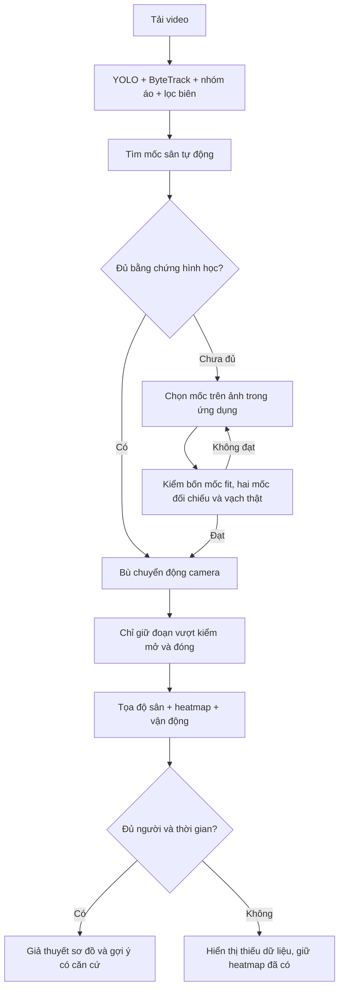

# Luồng tải video và phân tích trong ứng dụng

Ngày 31/10/2026. Theo yêu cầu hoàn thiện luồng, đã nối bước hiệu chỉnh
sân vào tác vụ tải video và thêm cách chọn mốc trên giao diện. Đây là
luồng kết hợp tự động/người dùng hỗ trợ, chưa phải hiệu chỉnh chính xác
hoàn toàn tự động cho mọi video.

## Người dùng thao tác

1. Mở `/video`, chọn video, bấm **Phân tích video**. Không cần chạy lệnh
   hoặc chuẩn bị file tracking riêng.
2. Theo dõi ba trạng thái: tracking người; hiệu chỉnh sân; heatmap và
   chiến thuật. Tracking xong không tự được gọi là phân tích xong.
3. Khi có tọa độ, sân mini tự nạp và đồng bộ video; heatmap, vận động,
   các giả thuyết sơ đồ và gợi ý xuất hiện trên các đoạn đủ dữ liệu.
4. Nếu cần bổ sung, bấm **Tới đoạn chưa có tọa độ**, tua tới ảnh rõ vạch,
   rồi **Chụp khung hình hiện tại**. Chọn mẫu mốc tương ứng phần sân.
5. Bấm lần lượt sáu giao điểm trên ảnh lớn theo sơ đồ đánh số: bốn mốc
   hiệu chỉnh và hai mốc khác để đối chiếu. Có thể phóng ảnh 2×/3×,
   cuộn ảnh, đổi loại mốc hoặc sửa từng điểm.
6. Bấm **Áp dụng mốc và phân tích tiếp**. Máy tính lại kết quả; không
   bắt đầu lại detector người. Mốc không hợp lệ được báo ngay và không
   thay kết quả cũ. Có thể bổ sung mốc ở các thời điểm khác.

URL tự lưu `?job=<id>`. Mở lại URL hoặc tải lại trang sẽ lấy video nguồn
và kết quả từ máy chủ cục bộ. Không cần tải lại video chỉ vì reload.
Tác vụ vẫn cần dữ liệu trong `data/processed/video_jobs/<id>`.

## Thứ tự xử lý

## Kiểm soát chất lượng

- Trọng số mốc sân phải tồn tại đúng SHA256 đã khóa. Thiếu hoặc sai
  trọng số không chặn nhánh chọn mốc tay. Không tải model ngầm/cloud.
- Nhánh tự động dùng phương pháp bốn đường đã thử ở phiên trước, lấy
  một ảnh mỗi giây khi mất dấu hoặc gần giới hạn chuỗi camera.
- Nhánh tay yêu cầu sáu cặp điểm khác nhau, trong ảnh/sân và đúng hash
  nguồn. Bốn điểm đầu không có bộ ba thẳng hàng; ma trận không có
  horizon cắt sân. Hai điểm cuối không tham gia fit, max lỗi ≤1m.
- Kiểm mốc tay trực tiếp trên khung video phía máy chủ trước khi lưu:
  đường giữa sân/biên/vùng cấm/vòng tròn được chiếu về ảnh để so pixel
  trắng gần cỏ. Mốc không bám vạch bị trả 422, giữ kết quả cũ.
- `CameraMotion` giữ nguyên kiểm optical flow/inlier/độ phủ/biến dạng
  và giới hạn 300frames. Không nối vận động qua mất dấu hoặc đổi mốc.
- Kiểm vạch tại đầu, mỗi khoảng một giây và cuối clip. Cần ≥3 dấu/vạch
  đủ quan sát, có cả họ x và y; các vạch đủ điều kiện đều phải có median
  lệch ≤4px và ≥65% mẫu cách pixel trắng ≤5px. Vòng tròn tính thêm khi
  đủ mẫu nhìn thấy. Các ngưỡng pixel chưa chuẩn hóa mọi độ phân giải.
- Giữ buffer tối đa khoảng một giây; chỉ ghi khi kiểm đóng đạt. Nếu
  mất dấu/kiểm không đạt, bỏ buffer chưa đóng, không xuất vị trí qua gap.
- Điểm chân ngoài sân 105×68m bị bỏ; không clamp. PitchSmoother và
  PitchMetrics hiện có vẫn lọc bước nhảy, giới hạn vận động 40km/h.
- Heatmap là thời gian vị trí được nhìn thấy, không phải kiểm soát bóng.
  Chiến thuật vẫn yêu cầu ≥4 người cùng nhóm và ≥5s hỗ trợ theo policy
  hiện có; không bịa danh tính, người khuất hay trạng thái có bóng.

Những kiểm tra này không phải kiểm chứng sai số thực địa độc lập. Các
kết quả luôn là ước lượng, sân105×68m là giả định đã được người dùng
chọn. Khi chỉ có một phần dữ liệu, trạng thái phải là `partial`.

## API và lưu kết quả

Các DTO của tác vụ là nội bộ, không sửa DATA_CONTRACT/TrackingRow.

| API | Vai trò |
|---|---|
| POST `/api/video-jobs` | Upload rồi chạy tracking → hiệu chỉnh → tổng hợp |
| GET `/api/video-jobs/{id}` | Tiến độ và workflow ba bước |
| POST `/api/video-jobs/{id}/calibration` | Body6cặp điểm để hiệu chỉnh; JSONnull để thử tự động lại |
| POST `/api/video-jobs/{id}/cancel` | Dừng tác vụ đang chạy |
| GET `/api/video-jobs/{id}/source` | Video gốc, hỗ trợ Range để mở lại/seek; không phải ảnh phân tích vẽ sẵn |
| GET `/api/video-jobs/{id}/pitch-estimate` | Phạm vi, heatmap, vận động ước lượng |
| GET `/api/video-jobs/{id}/pitch-tracking` | Các TrackingRow hợp lệ |
| GET `/api/video-jobs/{id}/tactics` | Giả thuyết và gợi ý từ vị trí quan sát |

Một khóa xử lý chung ngăn upload/hiệu chỉnh GPU đồng thời. Trạng thái
hiệu chỉnh lưu riêng; restart khi đang chạy sẽ báo gián đoạn, không
giả vờ hoàn tất. Hủy sau khi tracking xong vẫn giữ được tracking.

Mỗi lần hiệu chỉnh ghi vào thư mục bất biến `pitch_runs/<version>`:
tracking.jsonl, report.json, tactics.json. Chỉ đổi con trỏ
`pitch-current.json` sau khi mọi file hoàn tất. API ghim một phiên bản
cho cả báo cáo và tracking trong mỗi request, kiểm hash tọa độ trước khi
trả. Hủy/lỗi không đổi con trỏ. Kết quả và context của clip mẫu cũ vẫn
được đọc theo đường `pitch_estimate`; context cũ không gán sang tọa độ
phiên bản mới.

Mốc tự động đã có được giữ để nhánh tay tái sử dụng mà không cần nạp
GPU. Mốc tay lỗi không xóa mốc tự động cũ. Nút thử lại tự động cho phép
chạy lại finder ngay cả khi đã lưu mốc tay. Giới hạn kết quả180.000rows/
18MiB; khi chạm giới hạn, giữ phần đã có và yêu cầu cắt clip ngắn hơn.

## Kiểm chứng đã chạy

- 420 kiểm thử Python đạt,1network deselected; thêm9 test luồng mới.
- Frontend build/lint và14Node test đạt; còn cảnh báo FastRefresh/bundle
  đã có. Không thêm dependency.
- Qua HTTP thật trên video52,367s `Video Project15.mp4`: upload, tracking
  GPU, hiệu chỉnh tự động, gửi mốc tay, đọc lại report/tracking/tactics,
  kiểm mốc sai trả422 mà không mất kết quả cũ, kiểm sourceRange206 và
  proxyVite/đường dẫn khôi phục trả200.
- Job kiểm: `2c8e7ffdb8fc432b9abab9e53bd53c8e`. Kết quả cuối8.336vị trí,
  hiệu chỉnh15,10s, các đoạn0–10,033s;22–24,033s;26–29,033s. Hai cửa sổ
  nhóm A/B đầu clip đủ hỗ trợ và có tổng hai mục gợi ý. Các đoạn ngắn
  khác báo thiếu dữ liệu chiến thuật.
- Mốc tay trong kiểm chức năng được chọn từ ảnh nguồn, không là nhãn
  kiểm độc lập. Đây là kiểm luồng/phạm vi, không tuyên bố accuracy toàn
  clip hoặc hoàn toàn tự động.
- Kiểm tra tương tác trình duyệt bị công cụ ComputerUse chặn do không
  xác định được URL Windows đủ tin cậy; không tiếp tục thao tác UI và
  không tuyên bố đã kiểm tra trực quan/click qua trình duyệt. Kiểm API,
  build, lint và unit/integration tests vẫn đã hoàn tất.

Báo cáo kiểm HTTP lưu tại `data/processed/upload_flow_verification/`,
bản tóm tắt khóa nguồn tại `docs/fixtures/upload_workflow_verification_v1.json`.

## Giới hạn còn lại

Tự động vẫn bỏ các đoạn thiếu mốc, thiếu biên hoặc chuyển cảnh. Người
dùng cần chọn thêm mốc để mở rộng phạm vi; chưa bảo đảm toàn bộ video
bất kỳ đều có heatmap/sơ đồ đúng. Chưa kiểm độ chính xác bằng đo đạc
độc lập. Không triển khai lại nhận diện chuyền/sút, nhận diện danh tính
hay mô hình chiến thuật ML/SHAP mới trong phiên này.
